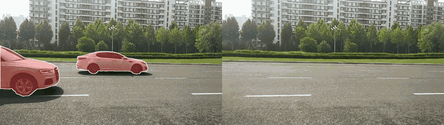
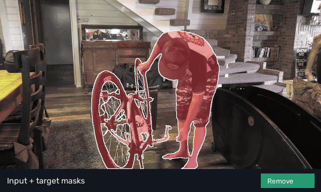

<h1 align="center">🎬 H3Remover<br><sub>Reinforcing Video Object Removal without Paired Data</sub></h1>

<p align="center">Kangjie Chen, Xiangyu Li, Jinhao Deng, …, Boyang Wang</p>

<p align="center">
  <a href="https://chenkangjie1123.github.io/H3Remover/"></a>
  <a href="https://huggingface.co/chenkangjie1123/H3Remover"></a>
  <a href="https://github.com/chenkangjie1123/H3Remover/blob/main/docs/H3Remover.pdf"></a>
</p>

Remove mask-selected objects and their associated visual effects while preserving surrounding scene details.

<table>
  <tr><th width="50%">🚗 Multi-vehicle street</th><th width="50%">🚲 Person and bicycle</th></tr>
  <tr>
    <td></td>
    <td></td>
  </tr>
</table>

<sub>Animated input → AI-generated output previews. <a href="examples/README.md">Example sources</a>.</sub>

## ⚡ Quick start

Use Linux, Python 3.13, FFmpeg, and a CUDA-capable PyTorch installation. The reference environment uses PyTorch 2.10.0 with CUDA 13. Install PyTorch for your system, then:

```bash
pip install -r requirements.txt
hf download chenkangjie1123/H3Remover --include '*.safetensors' '*.json' --local-dir weights/h3remover
```

Download the full-precision **Ref2VA** base and shared components from [MiniMax H3](https://huggingface.co/MiniMaxAI/MiniMax-H3):

```bash
hf download MiniMaxAI/MiniMax-H3 --revision 0919fb684102ef115126612f3fbb84d1027e7317 \
  --include 'modular_model_index.json' 'transformer_ref/*' 'text_encoder/*' \
  'tokenizer/*' 'processor/*' 'vae/*' 'audio_vae/*' 'scheduler/*' 'audio_scheduler/*' \
  --local-dir weights/MiniMax-H3
```

## ▶️ Inference

```bash
python infer.py \
  --base weights/MiniMax-H3 \
  --adapter weights/h3remover \
  --video examples/street/source.mp4 \
  --mask examples/street/mask.mp4 \
  --output outputs/result.mp4
```

Use a grayscale mask: **white marks target objects; black marks non-target regions**. Source and mask must share the same timing, frame count, and dimensions. The script creates the red reference overlay automatically from the binary mask.

The pipeline processes the first 5.17 seconds as 124 frames at 24 FPS, with aspect-preserving letterboxing to 960 × 544. Provide at least 5.17 seconds of synchronized video and mask. Output is a silent MP4. Use `--seed` to set the random seed and `--steps` to set the inference steps (default: 50).

Component CPU offloading and tiled VAE decoding are enabled to reduce GPU memory usage.

## 📜 License

The model is distributed under the [MiniMax H3 Community License](https://huggingface.co/MiniMaxAI/MiniMax-H3/blob/main/LICENSE). Download the base model separately from its official repository.
