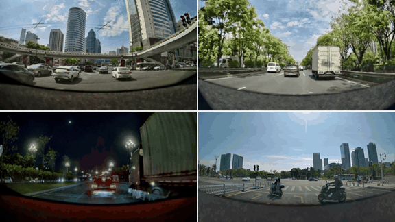
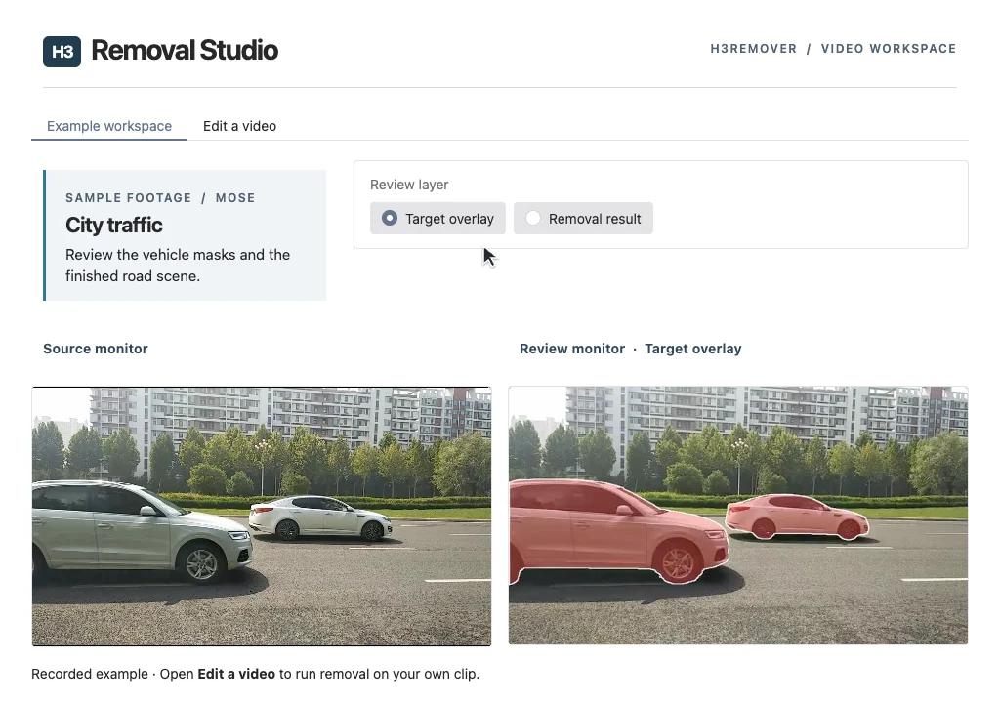

<div align="center">

<h2>🎬 H3Remover: Reinforcing Video Object Removal without Paired Data</h2>

<p><strong>✨ Remove Anything with H3Remover.</strong></p>

<p>
  <a href="https://chenkangjie1123.github.io/H3Remover/"></a>
  &nbsp;
  <a href="https://arxiv.org/abs/2611.24633"></a>
  &nbsp;
  <a href="https://huggingface.co/chenkangjie1123/H3Remover"></a>
</p>
<p>
  <a href="#overview">Overview</a> &nbsp;·&nbsp;
  <a href="#quickstart">Quickstart</a> &nbsp;·&nbsp;
  <a href="docs/training.md">Training</a> &nbsp;·&nbsp;
  <a href="#gradio-demo">Gradio Demo</a> &nbsp;·&nbsp;
  <a href="docs/inference.md">Inference Guide</a> &nbsp;·&nbsp;
  <a href="examples/README.md">Examples</a> &nbsp;·&nbsp;
  <a href="https://huggingface.co/chenkangjie1123/H3Remover">Weights</a> &nbsp;·&nbsp;
  <a href="#license">License</a> &nbsp;·&nbsp;
  <a href="#citation">Citation</a>
</p>
<p><a href="https://chenkangjie1123.github.io/H3Remover/#drive-title"></a></p>
<p><sub>Four street scenes, before and after removal with our driving model variant. <a href="https://chenkangjie1123.github.io/H3Remover/#drive-title">Compare all 20 driving scenes</a> · <a href="https://chenkangjie1123.github.io/H3Remover/#explore">Explore the 88-example gallery</a></sub></p>

</div>

## Overview

**Remove objects. Preserve the scene.** H3Remover (H3 Remover) uses reinforcement learning for video object removal: removing mask-selected objects and their associated visual effects while preserving surrounding scene details, without paired training data.

- **Mask-guided editing.** Select one or multiple objects with a video mask.
- **Simple inference.** Download the adapter and base weights with one command, then run the included example.

## Quickstart

### 1. Install

Use **Linux**, an **NVIDIA GPU**, and **FFmpeg**. The reference environment uses Python 3.13 and PyTorch 2.10.0 with CUDA 13:

```bash
git clone https://github.com/chenkangjie1123/H3Remover.git
cd H3Remover
conda create -n h3remover python=3.13 -y
conda activate h3remover
python -m pip install torch==2.10.0 torchvision==0.25.0 --index-url https://download.pytorch.org/whl/cu130
python -m pip install -r requirements.txt
```

Install FFmpeg with your system package manager. See the [inference guide](docs/inference.md) for environment checks and input details.

### 2. Download weights

```bash
python download_weights.py
```

This downloads the pinned adapter and full Ref2VA base to `weights/`, verifies the adapter checksum, and reuses completed downloads. If prompted for access, accept the license on the [adapter](https://huggingface.co/chenkangjie1123/H3Remover) and [base](https://huggingface.co/MiniMaxAI/MiniMax-H3) pages, then run `hf auth login` and retry.

### 3. Remove objects

```bash
python infer.py \
  --video examples/street/source.mp4 \
  --mask examples/street/mask.mp4 \
  --output outputs/result.mp4
```

Replace the example paths with your own video and mask. **White selects objects to remove; black keeps the rest.** Source and mask must have matching dimensions, frame count, and FPS. The red reference overlay is created automatically.

The output is a silent **124-frame, 24 FPS, 960 × 544** MP4. Provide at least **5.17 seconds**; longer inputs use the first clip. CPU offloading and tiled decoding are enabled.

<a id="gradio-demo"></a>

## 🏃‍♂️ Gradio Demo

<p align="center"></p>

**City traffic in Removal Studio.** The source stays on the left. Switch the review monitor from **Target overlay** to **Removal result** to inspect the saved edit. The walkthrough uses a prerecorded model output; **Edit a video** runs the model on your own footage.

After the [quickstart installation](#quickstart), launch the local editor:

```bash
python -m pip install -r examples/studio/requirements.txt
python examples/studio
```

Open **http://127.0.0.1:7860**, load an example or upload a video and binary mask, then **Preview targets → Remove selected objects**. Previewing an uploaded mask does not need model weights. Live editing uses your local CUDA GPU and the weights from the quickstart. The **Example workspace** opens immediately with a saved example; switch review layers without running inference.

For automatic street masks, install the [optional models](docs/automatic-removal.md) and set `PI4_PYTHON` and `SAM31_PYTHON` to their Python executables before launching. The interface binds to localhost and does not create a public share link.

## Examples and guides

| What you have | Where to start |
| --- | --- |
| No footage yet | [Ready-to-run video and mask pairs](examples/README.md) |
| A video and a mask | [Inference guide](docs/inference.md): preview targets, use local weights, or change the sampling seed. |
| A street video without a mask | [Automatic street removal](docs/automatic-removal.md): SAM selects people and vehicles, including parked ones; Pi4 finds other moving targets for SAM to segment. Preview the combined mask before removal. |

## Training

[Train the paper's Full method](docs/training.md) with your own videos and object masks. The [training code](pipeline/training/) uses DiffusionART to update a LoRA adapter on the frozen Ref2VA backbone, without paired object-free videos.

## Citation

```bibtex
@misc{chen2026h3removerreinforcingvideoobject,
  title         = {H3Remover: Reinforcing Video Object Removal without Paired Data},
  author        = {Kangjie Chen and Xiangyu Li and Jinhao Deng and Dongbin Zhang and
                   Chaoda Zheng and Shijia Chen and Yuqi Zhang and Choo Sin Wai and
                   Boyi Sun and Puyi Wang and Yu Zhang and Xianming Liu and Boyang Wang},
  year          = {2026},
  eprint        = {2611.24633},
  archivePrefix = {arXiv},
  primaryClass  = {cs.CV},
  url           = {https://arxiv.org/abs/2611.24633}
}
```

## License

The model is distributed under the [MiniMax H3 Community License](https://huggingface.co/MiniMaxAI/MiniMax-H3/blob/main/LICENSE). Download the base model separately from its official repository.
